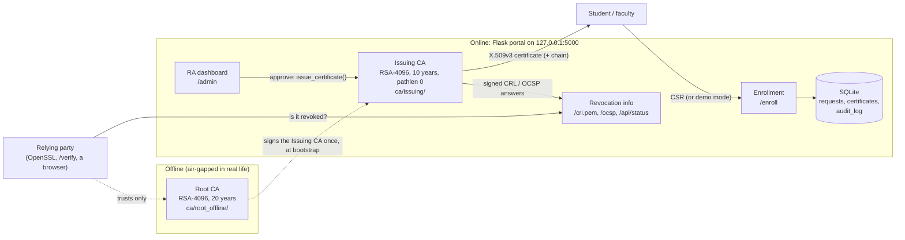

# VIT Campus CA Portal

A working demo of the Public Key Infrastructure designed in my BCSE330L case study for VIT Vellore:

**offline Root CA -> online Issuing CA -> Registration Authority (RA) -> end-entity X.509v3 certificates**,
with revocation (CRL, OCSP-style status, a real OCSP responder), an audit log, and signed documents whose
signatures anyone can verify.

Built with Python, Flask, the `cryptography` library, SQLite and Jinja2 (plain CSS, no JavaScript).
OpenSSL is used only to cross-check the results.

## Features

| Area | What you can do |
| --- | --- |
| CA hierarchy | `scripts/bootstrap_ca.py` creates an RSA-4096 Root CA (20 years) and an RSA-4096 Issuing CA (10 years, `pathlen:0`), or imports your existing CA |
| Enrollment | `/enroll`: choose a role, then one of that role's templates; upload a CSR, or use demo mode (the server makes the key and gives you a `.p12`) |
| RA workflow | `/admin`: approve (issues the certificate) or reject with a reason; the applicant follows progress with a tracking ID |
| Templates | `student_auth`, `faculty_email`, `server_tls`, `code_signing`, with fixed key types, lifetimes and extensions |
| Lifecycle | `/admin/certs`: status, days left, certificates expiring within 30 days highlighted; detail page; revoke with a reason |
| Revocation | signed CRL at `/crl.pem` and `/crl.der`; `/api/status/<serial>`; OCSP responder at `POST /ocsp` |
| Signing | `tools/sign_file.py`, `tools/verify_file.py`, `/sign` (demo) and `/verify`: five PASS/FAIL checks |
| Audit | every action is logged (who, what, when); `/admin/audit` with CSV export |
| Command line | `python -m app.cli issue ...`, `python -m app.cli revoke ...`, plus two demo scripts |

## Architecture

Key rules the code enforces:

- **The web app never loads the Root CA key.** No setting points to `ca/root_offline/`, and a test fails if any string in `app/` mentions it.
- **The CA trusts the CSR only for its public key**, after checking the CSR's signature (proof of possession). The subject comes from the RA-verified identity, and every extension and the lifetime come from the template.
- **CA passphrases come only from environment variables** (`ROOT_CA_PASS`, `ISSUING_CA_PASS`). They are never in a file, in `app.config`, or in git.

## Case study -> implementation

Section 5.2 (templates) is from the report. Fill in the other section numbers from your own report.

| Report | Topic | Implemented in |
| --- | --- | --- |
| § __ | Two-tier hierarchy, offline root, online issuing CA | `scripts/bootstrap_ca.py`, `ca/root_offline/`, `ca/issuing/` |
| § __ | CA key protection (encrypted keys, passphrases) | `bootstrap_ca.py` (PKCS#8, `BestAvailableEncryption`), `ca_core.load_issuing_ca` |
| § __ | Registration Authority, identity verification | `/enroll`, `/admin`, `routes_user.py`, `routes_admin.py` |
| 5.2 | Certificate templates and role -> template matrix | `app/templates_def.py`, `ca_core.build_certificate` |
| § __ | Certificate profile (X.509v3 extensions, serials, validity) | `ca_core.build_certificate`, `tests/test_ca_core.py` |
| § __ | Key generation and enrollment (CSR, PKCS#12) | `/enroll` (CSR upload / demo mode), `ca_core.build_pkcs12` |
| § __ | Revocation: CRL, status checking, OCSP | `ca_core.revoke_certificate`, `publish_crl`, `/crl.pem`, `/api/status`, `/ocsp` |
| § __ | Certificate lifecycle and expiry monitoring | `/admin/certs`, detail page |
| § __ | Non-repudiation, document / code signing | `app/signing.py`, `tools/sign_file.py`, `tools/verify_file.py`, `/sign`, `/verify` |
| § __ | Secure e-mail (S/MIME) | `faculty_email` template, `scripts/smime_demo.sh` |
| § __ | Auditing and accountability | `app/audit.py`, `/admin/audit`, CSV export |
| § __ | Limitations and future work | "Limitations and future work" below, `docs/SECURITY_NOTES.md` |

## Setup

Requirements: Python 3.11 or newer and Git. OpenSSL is only needed for the cross-checks; on Windows it
comes with Git Bash. Run everything from the `campus-ca-portal` folder.

### 1. Virtual environment

PowerShell:

    python -m venv .venv
    .\.venv\Scripts\Activate.ps1
    pip install -r requirements.txt

Git Bash (or Linux / macOS, where the script is in `.venv/bin/activate`):

    python -m venv .venv
    source .venv/Scripts/activate
    pip install -r requirements.txt

### 2. Create the CA (once)

CA passphrases come from environment variables, so they are never written to a file. Set them in the
terminal you use; they last until you close it.

PowerShell:

    $env:ROOT_CA_PASS    = "choose a root passphrase"
    $env:ISSUING_CA_PASS = "choose a different issuing passphrase"
    python scripts/bootstrap_ca.py

Git Bash:

    export ROOT_CA_PASS='choose a root passphrase'
    export ISSUING_CA_PASS='choose a different issuing passphrase'
    python scripts/bootstrap_ca.py

This creates the git-ignored `ca/` folder:

| Path | What it is |
| --- | --- |
| `ca/root_offline/` | Root CA private key + certificate. **Move this folder offline** when you are done; the web app never reads it. |
| `ca/issuing/` | Issuing CA key, CSR and certificate, a public copy of the Root certificate, and `chain.pem` (issuing + root). |
| `ca/issued/`, `ca/crl/` | Issued certificates and the current CRL. |

The script refuses to run again while a CA exists, because a new CA would make every certificate
issued so far untrusted. To start over, delete the `ca/` folder (and `instance/`) yourself.

**Using your own CA instead:** put `root-ca.crt`, `issuing-ca.crt` and `issuing-ca.key` into `existing_ca/`
and run the same command. Only `ISSUING_CA_PASS` is needed (it must be the key's passphrase if the key is
encrypted), and no Root key is required.

### 3. Run the portal

`ISSUING_CA_PASS` must be set in this terminal, because approving a request unlocks the Issuing CA key.

    python run.py

Open http://127.0.0.1:5000. (If port 5000 is busy, set `PORT`, e.g. `$env:PORT = "5001"`.)

### 4. Run the tests

    pytest

## Using the portal

1. **Request a certificate**: choose student or faculty (only that role's templates are offered), fill in
   name, e-mail and registration number, and then either upload a CSR or tick **Demo mode**. Keep the
   tracking ID.
   - No CSR at hand? Run `python scripts/make_sample_csrs.py` and upload a file from `demo_work/` (it also
     writes samples the CA must refuse).
2. **RA dashboard** (`/admin`): check the details, then **Approve and issue** or **Reject** with a reason.
3. **Status page** (`/request/<tracking ID>`): download `cert.pem` and `chain.pem`, plus `cert.p12` for demo
   mode. The `.p12` password is shown **once**, on the first visit after approval.
4. **Certificates** (`/admin/certs`): status and days left; open one to see its fields and to **Revoke** it.
   Each revocation publishes a new signed CRL.
5. **Sign a file** (`/sign`, demo only) and **Verify a signature** (`/verify`).
6. **Audit log** (`/admin/audit`), with CSV export.

| Template | Key the CSR must have | Valid for | Purpose |
| --- | --- | --- | --- |
| `student_auth` | RSA, at least 2048 bits | 365 days | TLS client authentication |
| `faculty_email` | RSA, at least 2048 bits | 730 days | S/MIME e-mail (SAN = the e-mail address) |
| `server_tls` | EC P-256 | 365 days | TLS server; needs one or more DNS names |
| `code_signing` | RSA, at least 3072 bits | 730 days | Code and document signing |

Students may request `student_auth` and `code_signing`; faculty may request `faculty_email`, `code_signing`
and `server_tls`.

## Command line

All of these need `ISSUING_CA_PASS` set, except the verification ones.

    # make a CSR with OpenSSL (Git Bash; MSYS_NO_PATHCONV stops Git Bash rewriting "/CN=...")
    export MSYS_NO_PATHCONV=1
    openssl req -new -newkey rsa:2048 -nodes -keyout demo_work/asha.key -out demo_work/asha.csr -subj "/CN=me"

    # issue and revoke
    python -m app.cli issue --template student_auth --name "Asha Rao" --email asha.rao@vit.ac.in --regno 21BCE0001 --csr demo_work/asha.csr
    python -m app.cli revoke --serial <serial> --reason keyCompromise

    # sign and verify a file (a code_signing .p12; password from P12_PASSWORD or a prompt)
    openssl pkcs12 -export -inkey demo_work/ravi.key -in ca/issued/<serial>.pem -certfile ca/issuing/chain.pem -out demo_work/ravi.p12
    python tools/sign_file.py --p12 demo_work/ravi.p12 --file report.pdf
    python tools/verify_file.py --file report.pdf --crl-url http://127.0.0.1:5000/crl.pem

### Demo scripts (Git Bash)

    bash scripts/demo_end_to_end.sh    # bootstrap, issue, verify, revoke, CRL check, sign, verify, tamper test
    bash scripts/smime_demo.sh         # faculty S/MIME: openssl cms -sign / -verify, tampering detected

Both scripts build a throw-away CA in `demo_work/` and never touch your real `ca/`. Every step states what
it expects, and they end with a summary (exit code 0 = everything as expected). Their output is saved in
[docs/demo_output.txt](docs/demo_output.txt) and [docs/smime_demo_output.txt](docs/smime_demo_output.txt).

### Checking things with OpenSSL

    openssl x509 -in ca/issued/<serial>.pem -text -noout
    openssl verify -CAfile ca/issuing/root-ca.crt -untrusted ca/issuing/issuing-ca.crt ca/issued/<serial>.pem
    curl -s -o crl.pem http://127.0.0.1:5000/crl.pem && openssl crl -in crl.pem -text -noout
    openssl verify -crl_check -CAfile ca/issuing/root-ca.crt -untrusted ca/issuing/issuing-ca.crt -CRLfile crl.pem ca/issued/<serial>.pem
    openssl ocsp -issuer ca/issuing/issuing-ca.crt -cert ca/issued/<serial>.pem -url http://127.0.0.1:5000/ocsp -CAfile ca/issuing/chain.pem

A revoked certificate fails `verify -crl_check` with `error 23 at 0 depth lookup: certificate revoked`.
To check a signed file by hand, see [docs/VERIFY_WITH_OPENSSL.md](docs/VERIFY_WITH_OPENSSL.md).

## Project layout

    app/                  the Flask application
      __init__.py         app factory
      config.py           settings (no secrets; no path to the Root key)
      db.py               SQLite schema: requests, certificates, audit_log; `flask --app app init-db`
      templates_def.py    the four certificate templates and the role matrix
      ca_core.py          load the Issuing CA, issue certificates, revoke, CRL, OCSP, status
      signing.py          sign files, and the five verification checks
      audit.py            audit log writer
      routes_user.py      enrollment, status, downloads, CRL, status API, OCSP, sign, verify
      routes_admin.py     RA dashboard, certificate list and detail, revocation, audit log
      cli.py              python -m app.cli issue | revoke
      templates/, static/ Jinja pages and style.css
    scripts/              bootstrap_ca.py, make_sample_csrs.py, demo_end_to_end.sh, smime_demo.sh
    tools/                sign_file.py, verify_file.py
    tests/                pytest suite (run `pytest`)
    docs/                 SECURITY_NOTES.md, DEMO_SCRIPT.md, VERIFY_WITH_OPENSSL.md, demo outputs
    ca/, instance/, demo_work/, existing_ca/    generated or private, all git-ignored

## Screenshots checklist (for the report or the slides)

- [ ] Home page with the trust-chain explanation
- [ ] Enrollment step 1 (role cards) and step 2 (form with the template cards)
- [ ] An enrollment refused with a clear message (e.g. `bad_rsa1024_too_small.csr`)
- [ ] Request status page: PENDING, then APPROVED with downloads
- [ ] Demo-mode status page with the one-time `.p12` password and the DEMO ONLY banner
- [ ] RA dashboard with a pending request (and the "authentication omitted" note)
- [ ] Certificates list with VALID / EXPIRED / REVOKED badges
- [ ] Certificate detail page (key usage, EKU, SAN, fingerprint)
- [ ] `openssl crl -text` showing the revoked serial, and `openssl verify -crl_check` failing
- [ ] `/verify` with five PASS, then a tampered file (check 1 FAIL), then a revoked signer (check 5 FAIL)
- [ ] Audit log page
- [ ] `bash scripts/demo_end_to_end.sh` summary: "DEMO COMPLETED"

## Limitations and future work

This is a demo. [docs/SECURITY_NOTES.md](docs/SECURITY_NOTES.md) lists exactly what is demo-only and what is
built the way a real CA would build it. The main next steps:

- **HSM for the CA keys**: today the Issuing CA key is decrypted into the app's memory, and the Root key
  sits on the same disk until you move it offline. An HSM (or at least a smart card for the Root) would
  keep the keys non-exportable.
- **Authentication and MFA on the RA dashboard**, with separate RA accounts, plus CSRF protection on its forms.
- **OCSP stapling**: servers attach a fresh OCSP answer to the TLS handshake, so clients need not contact the
  responder. A dedicated OCSP-signing certificate would replace signing with the CA key.
- **RFC 3161 trusted timestamps**: they would prove *when* a file was signed, so signatures made before a
  revocation could stay valid. Today `signed_at` is only the signer's claim.
- **Automated enrollment (SCEP / ACME)** for devices and servers, instead of the web form.
- **Blockchain-anchored revocation**: publish a hash of each CRL to a public ledger, so nobody (including the
  CA) can quietly rewrite revocation history.
- HTTPS, a production WSGI server, PostgreSQL, a tamper-evident (hash-chained) audit log, rate limiting,
  and a real e-mail check during enrollment.

## Tips (Windows)

- **VS Code shows "Cannot find module" on imports?** Press Ctrl+Shift+P, choose *Python: Select Interpreter*
  and pick the one in `.venv`.
- **Use `127.0.0.1` rather than `localhost` in commands.** `localhost` tries IPv6 first, and clients that try
  one address at a time (Python, PowerShell) then wait about 2 seconds.
- **Git Bash rewrites arguments that start with `/`**, which breaks `openssl ... -subj "/CN=x"`. Run
  `export MSYS_NO_PATHCONV=1` first.
- **"no Issuing CA found" when approving** means the CA has not been created yet (setup step 2), or the
  portal runs from a different folder.
